# FlexCell 当前架构与后续规划 — 2026-10-07

依据：当前源码基线 `a9b6a62`（已合并 PR #27）、E-020/E-021 归档、
ADR-001/002/003、ROADMAP，以及本 PR 的批次来源门禁。图中“已实现”表示
源码已有对应实现；机器人主机的实时健康状态不在本云环境的验证范围内。

## 当前架构

[高清 PNG](diagrams/current-architecture.png) ·
[可编辑 Mermaid 源码](diagrams/current-architecture.mmd)

任务入口是 CLI/场景 runner 的 `/run_demo` 和 `/run_pick_place`。
TaskFsmServer 内部包含四种可切换策略、确定性安全门、恢复预算和 EpisodeRecorder。
图中把这些内部模块合并在执行器节点，避免将它们画成不存在的独立服务。

- 决策层只选择任务动作：FSM、Jev、LLM、Hybrid；模型不直接控制关节。
- 快臂是已做 Q8 先导的 Clef-Flash 服务；慢臂是 DeepSeek 官方 API。
  模型请求有持久预算账本，来源、权重、校准和阈值有留痕。
- Observe 产生 WorldState v2；执行器补充任务上下文并生成统一规范输入。
  安全门之后才允许技能分发，所有策略共享执行与验证条件。
- Pick/Place 经 MoveToPose、MoveIt 2 和 ros2_control 驱动 Gazebo。
  Carry 后端按部署选择；Q8 先导用 teleport，velocity 实现有独立证据链。
- Verify 使用独立物理采样；决策正确、承载状态和物理成功是三种不同证据。
  CLI/admin 的启动、健康检查和 reset 是图外的生命周期路径。

实现位置见 [ARCHITECTURE.md](ARCHITECTURE.md)，完整数值与失败记录见
[EXPERIMENTS.md](EXPERIMENTS.md)。E-021 三臂 n=20 的成功率区间重叠，
目前不能声称 Hybrid 比 FSM 更可靠或更聪明。

## 后续规划

[高清 PNG](diagrams/development-roadmap.png) ·
[可编辑 Mermaid 源码](diagrams/development-roadmap.mmd)

蓝色为已实现的起点，黄色为本 PR，橙色为尚未定位的抓取失败；红色节点表示
n≥50 冻结仍有效。实线表示推进依赖，虚线表示独立实验或有条件的后续方向。
这是按证据门槛推进的规划，没有编造日历期限。

1. **本 PR：补齐来源门禁。** 真快臂调用和实测 tokens 必须存在，校准/指纹
   必须一致。完全慢臂替代 Hybrid 会停批；快臂运行后正常升级慢臂可以通过。
   合并后需在仿真机以新指纹重做 smoke，不继承旧资格。
2. **P0：定位抓取失败。** 为失败建立可复现的物理/承载探针，区分模型选择、
   承载机制和运动服务故障。保留失败，不能通过补采覆盖改变分母。
3. **完成 M2 资格。** 固定模型的重放、同指纹 smoke、独立验证和运行电池
   需要各自通过；离线单测不能代替 Gazebo 验收。
4. **进入 M3 小样本。** 预登记 S1-S7 差异化用例、FSM 免费对照、纯 LLM 付费
   对照及 Jev/Hybrid；当前 Q8 校准支持的阈值对照为 0.03/0.85。
   各臂固定自己的运行指纹，共享物理与验证条件，采用交错顺序。
5. **大样本与 Go/No-Go。** 证据达到门槛并人工解除冻结后才启动 n≥50。
   比较成功率、恢复、延迟、调用成本和校准；成本节省的参照是付费 LLM，
   FSM 仍是零 API 成本控制臂。
6. **有条件扩展。** MTC 是技能层的独立对照；接触抓取、视觉观测和真机
   后端分别由机制、观测和硬件目标触发。NVIDIA 开发沙箱只在测得开发工具
   瓶颈时推进，不引入第二个运行决策层。

本图不替代 ADR 审批，也不自动解除任何样本或机器人后端冻结。后续任务仍
通过 Issues、实验记录和 PR 审核推进。
