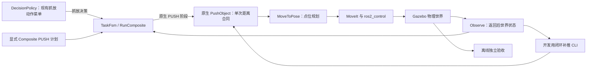

# EvoBot 架构攻坚审查（基于 d87f1701）

结论：目前首要瓶颈在**接触运动控制及其与任务结果的接口**。上层返回后反馈已经改善了
一个开发实例的完成表现，但低层仍不能可靠实现指定的单次位移；这个改进也尚未成为
Runtime Agent 可直接选择、组合的新技能。场景初始化、结果语义和自主开发入口是另外
三处明确的断点。以下区分源码事实、实测现象与待验证解释。

本轮包含源码审查、旧连续记录复核、一个新几何对照、一个初始化专用 Gazebo 检查。
不修改九个冻结文件、PushObject 核心、TaskSpec 或既有验收阈值，不升级正式基线。

## 实际调用链

证据边界：Runtime **已经**支持复合计划中的原生 PUSH，不能说它完全没有推动入口。
但 DecisionPolicy 的动作集合仍为 OBSERVE/PICK/PLACE/VERIFY/WAIT/ABORT；TaskGoal 仍表达
抓放 assignments。新的闭环 CLI 没有被这些决策/调度接口调用。CLI 还直接读取开发
TaskSpec 的 expected_goal，所以它是工程验证器，不是已证明遵守公开输入边界的 Agent。

参考源码：`decision_policy.py` 的 ACTION_ALL/TaskGoal，
`task_fsm_server.py::_native_push`，`run_push_feedback.py`，
`benchmark/tools/run_composite_plan.py::build_goal`。最后一个旧客户端仍按 place_pose
构建阶段，不能仅凭底层已有 PUSH 就假定整条规划入口支持它。

## 按阻塞能力的程度排序

| 优先级 | 架构断点 | 已有证据与影响 | 攻坚方向 / 推进条件 |
| --- | --- | --- | --- |
| P0 | 接触操作复用了通用点位规划 | 旧固定批次任务 3/3 通过，但候选五次单独推动全部 FAILED；MoveToPose 位置容差 20 mm，推动距离容差 5 mm，姿态不强制 | 建立实际碰撞表面的接触坐标和姿态条件，验证接近、接触、推进、脱离各阶段的连续路径；用原单次合同判定，不能只用宽任务区间 |
| P0 | 返回前位移与可继续执行状态没有完整的线上区分 | 核心在 retreat 前采样 after；retreat_failed 只进入日志，PushObject.action 没有对应字段；高位停留按原低目标未到达如实返回 | 分开记录 StrokeSatisfied、PostReturnObserved、ArmReady、GoalGeometryReached；缺失停止确认不允许下一动作。不得把 primitive FAILED 改名为成功来接入复合任务 |
| P0，已修基础适配器 | 泛化试验缺少通用场景实例化 | 现有专用 runner 固定 seed2000 和默认世界，只有初始匹配检查；不能据此直接运行任意新初始位置 | 新增启动前 materialize 和启动后真值 guard，Gazebo 新位姿/朝向验证通过；下一步把统一试验入口接到该适配器，而不是修改历史 runner |
| P1 | 已验证的工程控制器与 Runtime 能力注册之间断开 | 新 CLI 没有 Runtime 调用方；现有 composite 会拒绝五个失败的 primitive，即使最终区域条件成立 | 定义公开、类型化的任务目标与预算，提供可组合的恢复技能及结果收据；保留所有 primitive 结果和独立后验验收 |
| P1 | 释放判据混合了承载确认、夹爪状态和世界结果 | 历史两次普通回归失败，本轮之前一次普通回归通过；承载确认并不等于物体已脱离并稳定 | 先用物体真值、夹爪状态、无附着及后续运动条件做影子判定；不采纳“只凭 carry ack 报成功”的旧提案，不放宽阈值 |
| P1 | 自主改码主体与验收证据生产者的信任边界 | 既有 gate audit 已记录 rest_height/pusher_links 等产出方字段的可伪造性；九个文件哈希不覆盖全部证据模块 | 原生采集、配置/模型身份和答案由隔离验收侧持有；原始证据只追加。当前诚实实验的可追踪哈希不等于已能抵抗产出方伪造，不因此撤销已复核的物理结果 |
| P1 | 经验和自主开发仍未形成可执行闭环 | proposal loop 只生成/门控提案，没有 apply/build/Gazebo 闭环；生成器仍可产出已被记录为依据失效的 bounded_release_retry | 先让失效知识阻止旧提案再生成；L4 另需真实的隔离改码、构建、仿真、独立验收、回滚收据，不能用 Coding Agent 本轮工作冒充 |

已有的安全边界应保留：确定性 gate、executor 的预算所有权、typed cancellation、独立验收。
Composite 也已有 before/after/final 观察与后置条件，**并非完全开环**；它是在原生合同
先确认成功后才进入 after 检查。因此当前的问题是合同与能力类型衔接，不能靠删除这道检查解决。
失败后的世界观察也应成为恢复接口的一部分：记录可用的返回后状态，并保留原生失败，
才能判定下一步是补推、停止还是转入未知状态处理。

## 接触瓶颈的连续数据

来源：`setup/acceptance/evobot_contact_arch_audit_20261112/retained_contact_audit.json`。
对 B1/B2/B3 五次推进全部复核，另保留 pilot2 的两个推进作诊断，不混入原固定批次。
EE 位姿由原生 link5 世界位姿加 URDF 的 126 mm 固定变换得到；没有把原始 /tf 静态平移
当作末端世界坐标。五个坐标变换检查覆盖已知旋转及逆变换。

- **CONFIRMED：contact_made 不是接触传感器。** B1 第一次报告 contact_made=false，
  但推进区间有 140 个原生 pusher 接触步。字段按位移门槛定义，不能据它断言未发生碰撞。
  撤回这类通用推断；未逐个复核的历史试次仍不重新定性。
- **CONFIRMED：反向物体运动不要求末端反向。** pilot2 第二次推进中，实际 EE 正向
  62.6 mm，物体反向 16.9 mm，EE 最大回滑仅约 0.1 mm。粗略方向算术错误不足以解释它。
- **CONFIRMED：接触主要集中在顶部。** 五次固定批次推进中，逐接触物理步等权计算的
  顶部接触点占比约 0.64–1.00；这是物体坐标中的表面位置分类，不是推力或因果份额。
  实际手腕 pitch 在推进中变化约 7–11°，姿态未被强制。
- **UNKNOWN：摩擦、碰撞网格与姿态变化各自贡献多少。** 记录支持接触几何问题，尚不能
  证明唯一成因。所审查区间的最后一次接触持续至推进末尾，未观察到可独立归因于
  “失去接触后惯性滑行”的正向尾段；这不等于排除了接触过程中的冲击。

仅凭一个固定偏移补偿高度也没有成功。预注册 G0/G1 同实例、同预算对照：

| 条件 | 最终净前进 | 完整验收 | 单次推动合同 |
| --- | ---: | --- | --- |
| G0：原 EE 高度 20 mm | +106.664 mm | PASS，9/9 | 0/2；一次欠推，一次约 63.4 mm 超调 |
| G1：EE 高度 55 mm | 0.000 mm | FAIL：terminal / pusher_contact | 0/3，推进区间原生 pusher 接触步均为 0 |

55 mm 来源是已知手掌包围盒和实测 pitch 的几何假设，预注册明确它**不是注册后的实际
接触 TCP**。结果拒绝了这个配置，保留 20 mm 默认值。无有利替换、参数回调或混入旧
3/3 批次。这个结果表明下一步需要实际网格/姿态/接触面的校准和受约束路径；它不能
证明所有高度补偿均无效。本轮没有取得新的可靠单次推动能力。

## 本轮已经打通的部分

新增 `scripts/task_world.py`，提供可直接运行的 materialize / verify 子命令：

1. 只接受公开物体声明和已有同尺寸 box 模型，修改**启动前**的模型根初始位姿。
2. 拒绝缺失模型、尺寸变化、重复/非有限坐标、静态物体或相对坐标帧等不支持情形。
3. 不覆盖原场景或已有输出；指纹确认除初始 pose 外的世界属性保持相同。
4. 启动后按独立测量检查 xyz/yaw，位置沿用 1 mm 初始匹配条件；未知或错世界拒绝通过。

一个明确标为**初始化设施检查**的 Gazebo 场景将 A 设为
[0.23,0.015,0.0175,0.2]，B 设为 [0.20,-0.17,0.0175,-0.1]。
两个物体的独立位置误差约 2.5e−9 m，yaw 误差约浮点舍入量；旧开发坐标被 guard 拒绝。
没有派发推动或移动任务。CLI 另复现出与 Gazebo 实测文件逐字节相同的世界，并接受
实测初值、拒绝错误世界。八项离线设施检查通过。

这修复的是试验初始化能力。现有历史专用 runner 不被重写；通用任务 runner 的接入和
真正未见实例上的机器人操作仍是后续工作。初始化 PASS 不计入机器人任务成功数。

## 执行顺序和交付标准

1. **实际接触模型**：以手指真实碰撞表面、当前姿态和公开物体几何定义接触条件，
   分开验证“碰到了”“沿目标方向推进了”“按请求距离停止了”。不能把 EE 点高度叫接触高度。
2. **接触运动接口**：保持旧 PushObject 和冻结验收不动，在隔离新接口中验证受约束
   接近/推进/脱离。要求单次合同通过、返回后净位移与安全状态可复核，再争取小批重复。
3. **Runtime 可组合接入**：公开 typed goal、executor-owned 预算与取消、完整前后状态收据。
   不把 benchmark expected_goal 交给 Agent，不把宽区域目标偷换成原单次距离合同。
4. **回归与泛化**：统一入口使用新的初始化适配器；冻结实现和测试表后再验证新实例，
   保留失败。正式推广还需解决旧释放波动并通过既有审批边界。
5. **自主开发与迁移**：在上述可用执行/验收链上验证 Runtime 自己改码、构建和接受/拒绝，
   再做经验复用对照。生成 JSON 提案、增加文档和测试数都不是 L4 证据。

低难度记录/导航工作仍归 #231–#234；失效提案的生成前检查已发布为
[#236](https://github.com/Yenefa/flexcell/issues/236)，供 Junior 认领。
接触建模、运动合同及 Runtime 接入由主线承担。Formal T08 仍为 CALIBRATION_UNSUPPORTED，
L4 未获得，九个冻结文件和推动核心未改。
