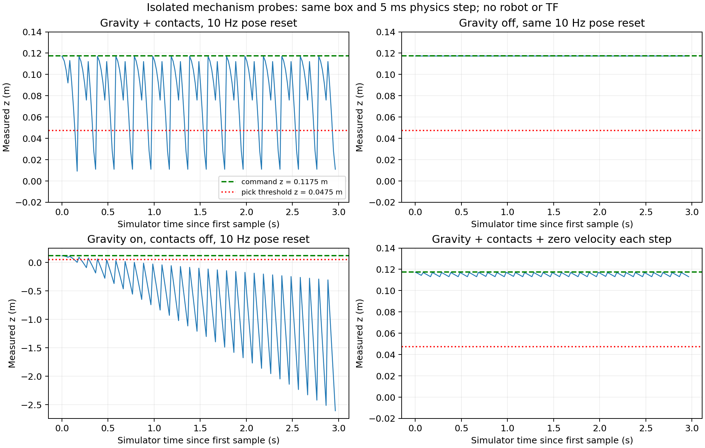

# DDS 与 teleport-servo 机制调查（E-014，2026-10-01）

本轮已定位一个可复现的 Fast DDS 发现失效机制，并通过干预支持了
servo 的速度累积机制。历史 Cyclone 已接受 action 的 GetResult 首次
应答丢失未在本轮搜索中复现，不能把两者合并成一个根因。
实验均为独立 ROS domain / Gazebo partition 的探针，不计入 benchmark。
现用 fleet、物理基线和 protocol v2 未切换；400 回合保持冻结。

## 1. DDS：本机 localhost 分片接收路径阻塞端点发现

### 可复现的触发条件

本机 ROS Jazzy，Fast DDS 2.14.6、rmw_fastrtps_cpp 8.4.4、rclpy 7.1.12。
两个独立进程分别创建 RunPickPlace action server/client 和
GetPlanningScene service/client；server 提前 2 s 启动，6 个 executor worker，
不发布模拟时钟，domain 159。UDP-only transport 使用默认报文上限。
动作只等待 20 ms 后返回探针 ID，**不调机器人技能，不调用模型**。

原客户端等 8 s 后仍看不到 action 的 feedback/status publisher；
再等 4 s 无恢复，同 participant 新建 ActionClient 也无恢复。
新建 participant（同进程新 Context，或另一个进程）则能使旧客户端恢复；
旧 scene 的真实查询和 action result 随后可返回。
这排除了“只需再等一会儿”和“重建同 participant 客户端”两个解释，
也说明恢复不依赖同进程的 Python / Context 全局副作用。

### 包级机制及干预

本机路由实测：

```text
127.0.0.1 via 169.254.73.152 dev loopback0 table 127
lo MTU=65536; loopback0 MTU=1500
```

Fast DDS 把多条 SEDP 端点信息合并成几 KB 到约 10 KB 的 UDP 报文，
走上述 localhost 路径后发生 IP 分片。
完整分片抓包中，27 个探针分片报文的发送方向均具有完整 offset 集合；
24 个报文的接收方向**仅有 offset 0**，另 3 个没有接收方向副本。
接收缺少后续分片，不能重组 UDP 报文。客户端持续 ACKNACK 请求
SEDP publication 序号 1..16，却未完成端点发现。
全局 IP 计数器在该次探针期间 ReasmReqds +24、ReasmOKs +0，作为旁证；
它不是按 socket 的独立证明。tcpdump 的 kernel drop 为 0，也不代表
镜像/过滤路径没有丢包。

只把 UDP transport 的 `maxMessageSize` 改为 **1400**，其余条件不变：

| 干预 | 初始发现 | scene 查询 | action 首次 GetResult | 抓包 |
|---|---|---|---|---|
| 默认上限，多次独立启动 | 8 s 失败；额外 4 s 仍失败 | 不可用 | 未到该阶段 | 大报文分片，接收不完整 |
| 1400，第一次 | 成功 | 8/8 | 8/8，无重读 | 本次未抓包 |
| 恢复默认上限 | 再次失败 | 不可用 | 未到该阶段 | 27 个分片报文，接收不完整 |
| 1400，第二次 | 成功 | 8/8 | 8/8，无重读 | 441 个帧副本，0 分片 |

据此，**这个可复现的 discovery 失效可归因于本机 localhost UDP
分片接收路径**。1400 字节批包是本机的有效规避机制。尚未定位到具体
Windows relay / 网络过滤组件的实现，不宣称已证明某一厂商代码缺陷。
新 participant 的恢复与发现消息重新调度成较小报文一致；不是应长期依赖的
恢复设计。其他主机必须按自己的路径 MTU 选择上限，1400 不是通用常量。

**抓包解释修正**：最初仅按 UDP 端口过滤的 pcap 会漏掉非首 IP 分片。
因此，初版解析中“序号 4..16 直到新 participant 才出现”不能作为
“服务器没有发送它们”的证据。完整发送方向重组确实包含这些序号，
包括 `get_resultReply`、feedback、status 和 `planning_sceneReply`。
原始解析保留，旁附
[局限说明](../setup/acceptance/mechanism_20261001/PORT_ONLY_CAPTURE_LIMITATION.md)。

### 历史 GetResult 丢失：搜索范围与充分条件

在已完成的自然虚拟动作中，Cyclone 150 次、Fast DDS 202 次，共 **352 次**，
首次与最终 GetResult 均无丢失；其中 16 次是上述 1400 干预。
计数包含真实 ROS/RMW 通信、1/6 executor worker、无时钟/200 Hz 时钟、
早/晚 GetResult、默认/UDP-only transport 的完成案例。
**启动失败和进程超时另存，未计为通过**。
早期 focused/stagger 两个可能重叠 domain 的案例明确标 INVALID，不参与结论。

这不是“证明永不发生”：未覆盖原机器人两层嵌套 action 全链路、
长时间运行、休眠恢复、接口变更、真实 MoveIt/controller 负载。
本轮没有定位历史 Cyclone 首次结果丢失的内部根因。已确认安装的
rclpy GetResult send/sequence 注册和 take_data 都有锁；不把旧版
sequence 注册竞态 issue 直接套到当前版本。

刻意在 **server 的 GetResult 应答发送处**注入故障：

| 注入 | 结果 | server 执行次数 |
|---|---|---|
| 每 goal 只丢首次应答，Cyclone 4 + Fast DDS 4 | 8/8 同 UUID 重读恢复 | 8 个 goal 各执行一次 |
| 持续丢全部应答，Cyclone 1 | 1/1 到截止时间仍失败 | goal 执行一次，7 次应答被丢弃 |
| Fast DDS 的 all 案例 | **注入未到达**：goal reply 超时 | 0；不能算第二个有效 all 注入 |

`AcceptedGoalResult` 的充分性是**有条件的**：已拿到 accepted handle，
server 已终结并仍缓存同 UUID 结果，server/participant 存活，链路在调用者
deadline 内恢复，并且至少一次 GetResult 请求/应答能送达及被 executor 处理。
探针复用了生产 helper，但把重读间隔从 5 s 缩成 0.15 s，截止时间为 0.8 s；
它证明同 UUID 的幂等读取和不重复执行，不能证明所有真实故障在 5 s 内恢复。
安装版本的默认结果保留时间为 900 s；保留时钟与 deadline 必须核对，
不能把过期后的 UNKNOWN 当成功。

**还需要的机制**：

1. 发现与结果读取分开处理。启动先确认 endpoint ready，并真正查询 scene；
   对 Fast DDS 在本机使用避免 IP 分片的 transport profile。重读无法修复发现失败。
2. 若丢的是 **SendGoal 接受应答**，尚没有 accepted handle，现有 helper 也无法覆盖。
   要在发出前保存 UUID，并以同 UUID 查状态/结果或给出 STATE_UNKNOWN，
   不能凭超时重发物理 goal。本轮未注入这类丢失，历史现象需按应答阶段区分。
3. 结果缓存消失、server 重启或持续断链时，依靠有界 deadline、typed UNKNOWN、
   取消及实测停机确认；不能把“没有结果”解释为“动作没有执行”。

当前 fleet 继续使用 Cyclone。上述 Fast DDS profile 是探针对照，未部署到 fleet。

## 2. Servo：位置传送没有清除动量，重力在多次传送之间累积速度

### 排除混杂与观测

独立 Gazebo Harmonic 8.15.0 partition，复制当前世界的 5 ms 物理步、
重力 -9.8 m/s²、ground plane，以及真实 target_box_b 的 35 mm / 0.05 kg 模型。
没有机械臂、TF 或偏移量；只周期性把物体传送到固定 `z=0.1175 m`。
以初始地面中心高度 0.0175 m + rise 阈值 0.03 m，定义阈值 `z=0.0475 m`。
它是解释机理的同尺度高度门，**不是一次真实 PICK 或 episode**。
Pose_V 约 50 Hz，保存 simulator time 和 monotonic wall time。

每组 3 s，共 12 组 gravity/collision/rate/schedule 对照：

| 对照 | 结果与含义 |
|---|---|
| 重力开、碰撞开、10 Hz | 两种调度下 20.13% / 27.66% 高度样本低于阈值；不是 episode 失败率 |
| 重力关、碰撞开、10/50 Hz，两种调度共四组 | z 恒为 0.1175 m，0 阈值跌落；即使出现请求超时也能保持 |
| 重力开、碰撞关 | 仍严重下落，最低可到 -3 m；接触求解不是产生失效的必要条件 |
| 只把位置更新提到 50 Hz | 仍有阈值跌落；加频率本身不充分 |

无碰撞、10 Hz、固定 deadline 的 30 段下落弧线，用 simulator time 拟合
`z(t)=a+v*t-4.9*t²`：每段初速随模拟时间的斜率为
**-9.800228 m/s²**，最大拟合 RMSE **0.000062314 m**。
这是从位置推断的速度，不是直接速度遥测。
结果支持：传送后物体带着此前累积的向下速度继续运动。
after_reply 的另一个自由落体组有请求时序抖动，拟合残差约 0.039 m，
不把它当同精度证据；重算算法和原初拟合都保留。

Gazebo 8.15 release-tag 的 Physics `WorldPoseCmd` 路径调用
`freeGroup->SetWorldPose`，该块没有重置线速度。这与观测一致；下载的上游
release-tag 源码不等于已证明发行商编译补丁完全相同。
可查 [Physics.cc](https://raw.githubusercontent.com/gazebosim/gz-sim/gz-sim8_8.15.0/src/systems/physics/Physics.cc)。

### 证伪干预：保持重力与相同位置更新，只控制速度

在独立模型加 VelocityControl，每个物理步将线/角速度设零；
重力仍开启，位置仍按 10 Hz 传送。碰撞开/关 × after_reply/fixed deadline
四组完整跑完，**四组均 0 阈值跌落**，最低 z 为 0.107945..0.11358 m，
包括请求超时带来的约 200 ms 间隙。
第一次 velocity-control 尝试只完成一组，第二物体 create 应答失败；
原失败保留，四组结论来自独立的完整 retry，不把部分尝试算成完整成功。



**机理解释**：pose-only servo 约束位置，没有约束动量。
重力持续积累向下速度；周期传送又把位置拉回，但下一物理步沿原速度下落。
地面接触会周期性改变速度/约束，命令请求间隙与取样相位决定验收时的高度。
因此，偏移不匹配、接触求解误差不是这个简化失效的必要条件；
更新率、负载、相位会放大或调制失效，而非唯一根因。
Boolean 请求成功也不证明某个物理步已经实现目标高度。

这为真实 `rise≈-0.003..-0.006 → GRASP_FAILED` 提供了可行机制，
**尚不能证明每个历史机器人失败都是它**。需要在真实 carry 上同录
目标/实测 pose、请求起止、sim time、速度、实际更新间隔和验收时刻来确认映射。

### 已执行和后续可证伪的实验

| 假设 | 证伪条件 | 本轮结果 / 下一步 |
|---|---|---|
| 主要由 pose reset 保留速度导致 | 去重力仍跌落，或逐物理步速度控制仍同样跌落 | 两个反事实均未出现，支持该机制 |
| 接触求解是必要根因 | 去碰撞后仍失效 | 已出现，排除其必要性 |
| 只需更快位置更新 | 提到 50 Hz 仍跌落 | 已出现，排除其充分性 |
| 偏移/TF 是必要根因 | 无机械臂、无偏移、固定目标仍失效 | 已出现，排除其必要性 |
| 能解释真实 carry 的失败 | 真实失败时实测速度无累积，或有界速度控制后同样失败 | 下一步在真实 carry 记录并干预，尚未执行 |
| 停用控制后能保持真实 release | disengage 后没有恢复自由落体 / 仍有速度约束 | 新 backend 必须通过的释放门，尚未执行 |

**路线裁决**：继续保留现有 servo 基线的已声明限制，优先开发
只在 engaged 阶段生效、release 恢复自由物理的速度感知磁性 carry。
不把当前失效接受为不可消除的噪声底，也没有证据要求马上改为接触抓取。
本轮永久 VelocityControl 仅是证伪工具，直接部署会阻止释放后的自由运动。
任何生产物理改动必须使用新的 backend/runtime fingerprint 和新批次，
不能靠降低 rise 阈值或延长 settle 等待来抹平失败，不能混入 E-011/v2 基线。

## 3. 真实模型使用与预算

模型仍是用户指定的官方 `deepseek-flash`，没有声称升级成更大参数模型。
本轮三次机制评审均为 `thinking=enabled`、`reasoning_effort=max`；
第一轮 completion 上限 32768，后两轮 65536。默认运行策略配置未改为此上限。
预算 guard 新增了受同一 5 元账本约束的 thinking/max 支持。

| 调用 | reasoning token | completion token（包含 reasoning） | 返回 | 费用上界 RMB |
|---|---:|---:|---|---:|
| 实验设计 | 27283 | 32768 | length，最终 JSON 被截断 | 0.288698 |
| 首轮实证评审 | 5393 | 7160 | stop，完整 | 0.063244 |
| 分片证据评审 | 7697 | 9649 | stop，完整 | 0.079426 |

本轮新增上界 **0.431368 元**；整个授权会话累计 **98 次、0.761626 / 5 元**，
无未结算请求。推理 token 已计入，账本使用高峰未缓存输入/输出的保守费率，
不是平台发票。费率来源：[官方定价](https://api-docs.deepseek.com/zh-cn/quick_start/pricing/)。
不保存或展示模型推理正文，仅保存其长度/hash、usage、最终意见及请求配置。

模型意见不是实验事实。最后评审请求时第二轮 1400 尚在运行，
模型正确标为未完成；报告使用随后实际完成的 16 次结果。
初步评审把两个 all 配置都描述为已执行故障；逐事件核对发现 Fast DDS
那个配置未到应答注入点，报告纠正为一个有效 all 案例。原输入/输出保留可审计。

## 4. 重现命令与证据

从仓库根目录执行，先 source `setup/104_mainline_env.sh`。
探针只操作自己的 domain / partition，serial 重跑；输出目录必须不存在。

```bash
python3 setup/112_dds_probe.py --out /tmp/dds_default_probe \
  --start-case 9 --end-case 10 --base-domain 150 --stagger-s 2 \
  --trials 8 --udp-only --recovery-control wait
python3 setup/112_dds_probe.py --out /tmp/dds_safe_probe \
  --start-case 9 --end-case 10 --base-domain 150 --stagger-s 2 \
  --trials 8 --udp-only --max-message-size 1400 --recovery-control wait
python3 setup/113_servo_probe.py --out /tmp/servo_position_probe --seconds 3
python3 setup/113_servo_probe.py --out /tmp/servo_velocity_probe --seconds 3 --velocity-control
python3 setup/114_rtps_analysis.py \
  setup/acceptance/mechanism_20261001/dds159_fragments.pcap \
  --out /tmp/rtps_analysis
python3 setup/115_mechanism_analysis.py --root setup/acceptance/mechanism_20261001
PYTHONPATH=$PWD/src/flexcell/flexcell_skills python3 -m pytest -q \
  src/flexcell/flexcell_skills/test/test_inference_budget.py
```

抓包命令使用 `host 127.0.0.1 and (udp portrange 47150-47250 or
(ip[6:2] & 0x1fff != 0))`，同时包含非首分片；解析器仅保留能与探针端口
首片关联的记录。限定 duration 的 tcpdump RC=124 是 timeout 正常收尾，
不计为未捕获；probe client RC=1 则确实代表初始发现失败。

- [DDS 分组计数](../setup/acceptance/mechanism_20261001/dds_counts.json)
- [完整分片方向证据](../setup/acceptance/mechanism_20261001/full_capture_analysis/fragment_summary.json)
- [1400 抓包解析](../setup/acceptance/mechanism_20261001/mtu1400_capture_analysis/fragment_summary.json)
- [12 组 servo 对照](../setup/acceptance/mechanism_20261001/servo_initial/summary.json)
- [四组速度控制干预](../setup/acceptance/mechanism_20261001/servo_velocity_control_retry/summary.json)
- [速度拟合重算](../setup/acceptance/mechanism_20261001/velocity_fit_recomputed.json)
- [预算快照](../setup/acceptance/mechanism_20261001/budget_snapshot.json)
- [证据 manifest](../setup/acceptance/mechanism_20261001/manifest.json)

## 5. 交接

Repo: `/mnt/c/dev/flexcell`。Remote: `https://github.com/Yenefa/flexcell.git`。
Branch: `main`。本轮开始 HEAD `145ae81`；调查期间用户工作新增了
`5878c05`（grasp-only probe），已保留，本轮未 commit/push。

Changed: 新增 111–115 诊断/分析脚本、独立 evidence 目录和本报告；
inference_budget 与对应测试支持同预算内 thinking/max；README、HANDOFF、
EXPERIMENTS 增加 E-014 指针。旧 E-013 evidence、主线配置与用户新增 probe 不改写。

Tests actually run: 上述 ROS 两进程对照和 Gazebo 探针按原始文件记录；
最终 budget 源码的目标 pytest **3 passed**；新脚本 AST 解析及
`git diff --check`，结果见 manifest 的 validation 字段。

Not run / limitations: 未重建 overlay、未部署物理或 RMW 修复、未再次执行
机器人全链路、未跑 400/n≥50 批次、未重跑全套单测/rosdep，未定位历史
Cyclone 结果丢失内部根因、gate_flood/reset139/MTC 未由本轮解决。
现用 installed fleet 仍为上一轮代码和非 thinking 策略配置，诊断预算代码
仅由 repo 脚本 source-import；不能声称诊断配置已上线。

Workspace status: 保留开工前已有 tracked/untracked 修改和 reset JSON，
本轮新增证据也未提交；完整结束状态在 manifest 旁的 `workspace_status.txt`。
