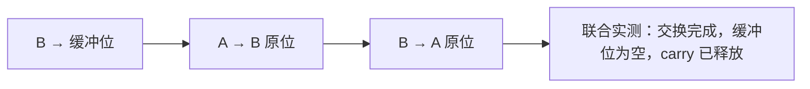

# TB-003：带缓冲位的三段交换组合

2026-10-06，完成已预登记的 FSM、Hybrid 各一次三段交换，以及各一次旧 S1 回测。
目标组合各 **1/1**，源任务各 **1/1**；共 8 份原生 episode，没有补采或替换。
**AC@90、实体安全验收、n≥50 均未解冻。**

## 任务与模型参与范围

初态 A=(0.22,0,0.0175)、B=(0.20,-0.18,0.0175)，复用已有缓冲位
(0.12,-0.15,0.0175)。先搬走 B 腾出目标，再搬 A，最后再次搬 B：



这是重复访问 B 的新依赖链，现有 RunDemo 的两个唯一对象 assignment 及完成集合
无法表示第三段。两臂都使用同一份固定外层执行器，调用已有 RunPickPlace，
模型决定每段内的 PICK/PLACE/VERIFY；**跨段编排已预先指定**，不能据此宣称模型
自行规划了三段依赖或获得通用组合泛化能力。它也不是 A/B 顺序互换的 T1 变体。

每段执行前用新 Observe 核对已提交的对象状态、目标位无其他对象中心落入 0.05m
范围；上一段未成功则不执行下一段。每段自身必须成功 Verify、有限非负误差
≤0.06m、同一 goal UUID、非信号退出。三段结束后再用**同一份新 Observe** 联合
核验 A/B 交换后的 XYZ、缓冲位清空、carry disengaged。buffer 空置采用已登记的
中心距离判据，不当碰撞安全验收。各观察和命令原始 JSON 均留存。

父级 `ACTUAL_COMPOSITE_TASK` 回执单独保存，三段保留不同的原生 run ID；没有
拼装一份假的 EpisodeSchema 记录。ledger 计原生 component trials，父级逻辑
组合 n=1 另报，两者不能相加充当独立样本。无 episode 的编排/初始化失败有
单独的 `T3-orchestration-check` cell，未知 ownership、信号、身份或路由失败停批；
普通任务失败结束该组合后仅执行已登记的源任务回测，不替换失败。

## 冻结起点与完整证据

- 起点 `1bcc7c09fede9d2b5cbb6afec4e375dd72ae0446` 包含学校启动探测修正；
  共享执行器注册前提交为 `96c233d552b604c7afeea47e959317d51c15a180`。
- [task manifest](plan/task_manifest.json)、[初态与依赖](plan/initial_states.json)、
  [成功谓词](plan/success_predicate.json)、[Skill 身份](plan/skill_contracts.json)
  和两臂配置全部在运行前封存。固定 FSM 后 Hybrid，最多 1 次组合和 1 次 S1/臂，
  最大 8 原生 episode；既有 ¥5 持久预算未清零，额外 ¥0.25 上界停止阈值只在边界检查。
- FSM fingerprint：`b673f3fda4ca050c3782054c564ac0cad19a34a68af1fb23bed7c7ffba470385`。
- Hybrid fingerprint：`9250f98b789514e57f3779d6efa326989b576d8e0bea925a6f37dd3f2dbbcf93`。
  Hybrid=0.85，启动探测=10s、推理=45s；prompt/model/calibration 没有调优。
  calibration SHA 为 `34eac55fcfdda978286df25b3f6a13f4047e4ca9002ec829d83f262073215f0c`。
- 新旧指纹不并池。[独立复核报告](report.json)重新解析 native/client、重算路由
  或 FSM replay、核对 goal UUID/指纹/账本主回执以及父子回执和最终 Observe。

## 结果按目的分开

| 臂 / 目的      | 逻辑任务结果 | 原生 episode | Clef / DeepSeek 决策 | GPU 调用 / 总 tokens | policy.decide p50 / p95       |
| -------------- | ------------ | ------------ | -------------------- | -------------------- | ----------------------------- |
| FSM T3 组合    | 1/1          | 3            | —                    | —                    | 0.008894 / 0.028559 ms，n=9   |
| FSM S1 回测    | 1/1          | 1            | —                    | —                    | 0.008954 / 0.018561 ms，n=7   |
| Hybrid T3 组合 | 1/1          | 3            | 9 / 0                | 9 / 12,561           | 2,798.661 / 3,745.726 ms，n=9 |
| Hybrid S1 回测 | 1/1          | 1            | 6 / 1                | 7 / 10,120           | 2,819.211 / 3,480.853 ms，n=7 |

时延均为保留小数的 `perf_counter_ns` 完整 policy.decide 测量，排除 bootstrap；
p95 使用 `(n-1)*q` 线性插值，n 是相关的段内决策数。它不是 GPU 单次推理时延。
所有非 bootstrap Hybrid 决策均来自模型，未出现 FSM fallback；FSM 原生回放全通过。
每臂 30 个 controller goal terminal 都为 status=4，无未知/隔离事件。

最终共同观察的对象中心：FSM A=(0.2090,-0.1761,0.0175)、B=(0.2152,0.0071,0.0175)；
Hybrid A=(0.1915,-0.1807,0.0175)、B=(0.2090,0.0025,0.0175)。两者都满足所登记的
交换后误差和缓冲位空置条件。初态、目标几何、对象和原子 Skill 固定，不能把
单次成功解释为 90% 可靠性、泛化达标或工程成本胜出。

## 工程成本与缺失

登记前新增共享组合执行器 **352 行**及 **59 行测试**，两臂复用这项工作；完整
[共享开发回执](plan/shared_development.json)记录 Git base→executor diff。
共享代码是迁移工程投入，不能以“每臂没有运行时补丁”声称零代码或零成本。
收尾还新增报告器和实录测试，这些工具开发/封存投入的时间与费用尚未完整计量。

从前瞻启动计时到执行器提交测得部分 elapsed **9.206653 分钟**；其中包含网络
回执交付开销，是 wall elapsed，不是专注开发时间。此前规划、网络修正、随后
报告器开发和封存工时未计量，不能把这个小计当完整迁移工时。两臂运行编排
elapsed 为 FSM **1.993695**、Hybrid **2.836982** 分钟，含策略切换/reset/执行。
人工活跃分钟、等待分钟、coding assistant tokens/费用仍 **NOT_RUN**；不填零。

T3 目标阶段未调用 DeepSeek，9 次 GPU 调用有 12,561 个总 tokens；输入/输出
拆分、能源和所有权成本未知。S1 回测单次 DeepSeek 为 1,510 input + 62 output，
峰时无缓存预算上界 **¥0.003516**，实际账单 **UNKNOWN**。源任务开销单列；
账本所有金额都为未知，`known_amount_subtotal=0` 不表示免费。

## 网络限制、验证与复核

这轮启动均确认 TCP 可达，校准 gate 通过。学校链路仍经 DERP(tok)，之前的
2 秒探测失败及本轮 2 秒/10 秒对照均保留在
[NET-001](../startup_health_20261006/README.md)。部署级截止时间解决短探测问题，
没有证明网络稳定性或解决直连根因，**network_stability=NOT_ACCEPTED**。

共享记录器/试点工具测试 **36 passed**，含 8 份实际 episode、两个联合观察结果、
重复 run ID、跨段顺序、缺测/NaN/carry、错误 UUID、-6/134 和只读复核；首轮 34
及最终 36 的输出均保留。启动修正另有 12 项针对性测试，所在 skills suite 为
260 passed。这些不当物理安全或大样本资格证据。

每个原生任务保存 client、episode、summary、前后预算、ROS 日志追加片段、
逐 API 主回执；初始化和逐段 Observe 位于 `composite/`。`source/` 保存执行源码，
`scripts/`、`validation/` 保存驱动与各次输出。没有凭据、权重或 build/install 产物。
账本仍用原始 WSL 绝对路径，镜像通过相对文件摘要复核，不改写其 hash chain。

```bash
cd /home/ros/agentic_workcell_ws
python3 setup/acceptance/transferbench_t3_20261006/scripts/verify_frozen.py
python3 -I -S -m unittest discover -s setup/transferbench -p 'test_*.py' -v
```

`SHA256SUMS.json` 封存确切文件集合。已开始的 arm 和 report 文件均拒绝覆盖；
再次只读报告应输出到回执外的新文件，不能重跑目标任务来替换证据。
